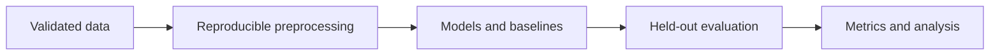
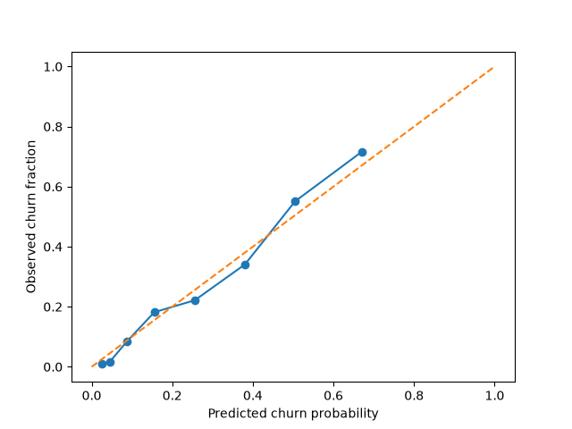
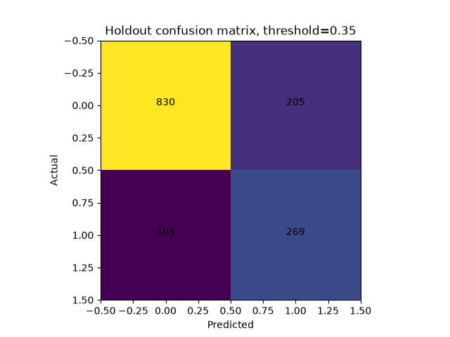

# Telecom customer churn: leakage-resistant classification

An end-to-end sklearn study with schema validation, seven baseline/hyperparameter candidates, train-only preprocessing, validation-selected threshold, held-out evaluation, explainability and a Streamlit dashboard.

## Research question and methodology
IBM Telco Customer Churn: 7,043 customers, target Yes/No. Stratified 60/20/20 train/validation/test splitting, seed 42. Customer ID excluded; blank TotalCharges becomes missing and train-median-imputed. One-hot unknown-safe categories, numeric standardization. Compare prior dummy, logistic C={0.1,1}, random forests depth={6,12}, and gradient boosting depth={1,2}. Select model by validation average precision, then threshold by validation F1. Do not refit on validation data, avoiding a changed probability scale after threshold selection. Test is evaluated once after these decisions. Permutation importance uses validation only. Logistic SHAP/log-odds explanations are explicitly separate from the selected model.



## Executed results
Executed on the real upstream CSV, SHA256 `16320c9c1ec72448db59aa0a26a0b95401046bef5d02fd3aeb906448e3055e91`. Selected `boost_depth1`, threshold 0.35. Holdout n=1409: accuracy 0.7800, F1 0.6344, ROC-AUC 0.8447, average precision 0.6666, Brier 0.1361. Logistic SHAP executed. Full comparison, calibration, confusion matrix, error-by-contract and contributions: [metrics](results/telco/metrics.json).




## Reproduce
From this repository root:
```bash
python -m pip install -e '.[dev]'
python scripts/download_data.py
python -m churn.cli --csv data/telco.csv --output results/telco
streamlit run src/churn/app.py
pytest -q
ruff check .
ruff format --check .
```

## Implementation and review
`src/` contains the package and CLI; `tests/` contains CPU-safe unit and integration checks; `configs/` records defaults; `results/` stores measured metrics, not large datasets or checkpoints. See [methodology](docs/methodology.md), [reproducibility](docs/reproducibility.md), [status](docs/IMPLEMENTATION_STATUS.md), [quality review](docs/QUALITY_REVIEW.md) and [limitations](docs/limitations.md).

Four tests cover schema rejection, blank values, unknown categories, train-fitted preprocessing, repeated-run metric equality, disjoint splits, saved model inference and CLI help. Streamlit startup and initial page are checked separately; browser upload interactions remain untested.

## Limitations and future work
One dataset and one seed; no external/temporal validation or causal interpretation. Data are a public sample, not a representative production customer population. Threshold optimizes F1 rather than business cost. No production recommendation. Dashboard loads trusted local joblib only. Raw data and checkpoints are not committed; retrain to recreate them. SHAP explanations describe the logistic comparison model, not gradient boosting. Missingness inspection is descriptive and does not fit transformations on holdout.

## References and licensing
Data: [IBM telco-customer-churn-on-icp4d](https://github.com/IBM/telco-customer-churn-on-icp4d), data/Telco-Customer-Churn.csv; upstream repository LICENSE is Apache-2.0 (retrieved during implementation). No separate dataset-specific license was found; raw data are not redistributed here. Review upstream terms for reuse. SHAP: Lundberg & Lee (2017), *A Unified Approach to Interpreting Model Predictions*, NeurIPS. sklearn metrics/Pipeline documentation.

Repository code: MIT; third-party data, pretrained weights and libraries retain their own terms. No affiliations, publications or independent authorship claims are made.
